<div align="center">

# due

**What your household has committed to pay this month, and what still needs you.**

A local-first Flutter app for iOS, macOS and the web. No account, no sync, no bank access.

[](https://github.com/Avinava/due/actions/workflows/gate.yml)


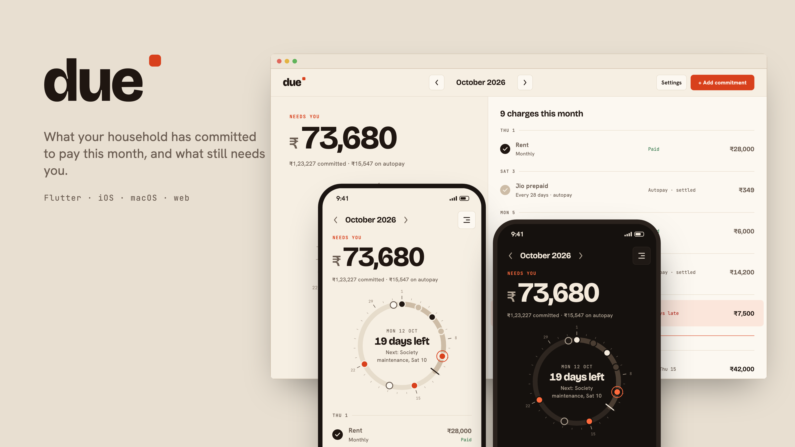

**[Try the web demo](https://avinava.github.io/due/)** · **[Browse the design kit](https://avinava.github.io/due/kit/)**

</div>

## The idea

Rent, school fees, society maintenance, the maid, a 28-day Jio plan, Netflix, an LIC premium, a car EMI. A household already knows it will pay these. The question each month is how much is committed, and which of it still needs someone to act.

Due answers that on one screen. The large number is what **needs you**. Autopay is counted as committed but never chased. The month is drawn as a dial you can scrub with a finger: tap an item to mark it paid, and the total counts down.

## Screens

Every image below is rendered from the real app by `mise run shots`, using the sample household on Mon 12 Oct 2026. The design they match is in [`design/`](design/README.md).

### The month

| 1a Month | 1b Day scrubbed | 1c Marked paid | 1d Nothing left |
|:-:|:-:|:-:|:-:|
| 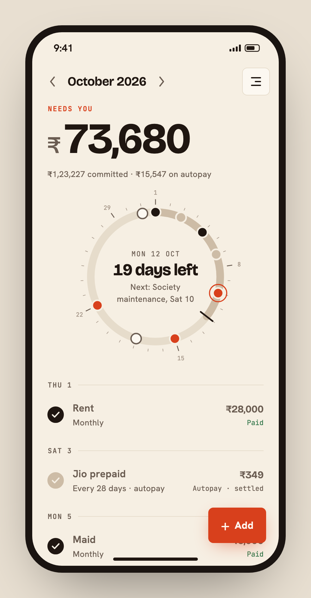 | 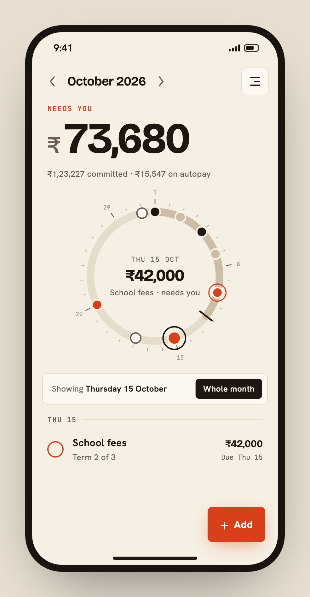 | 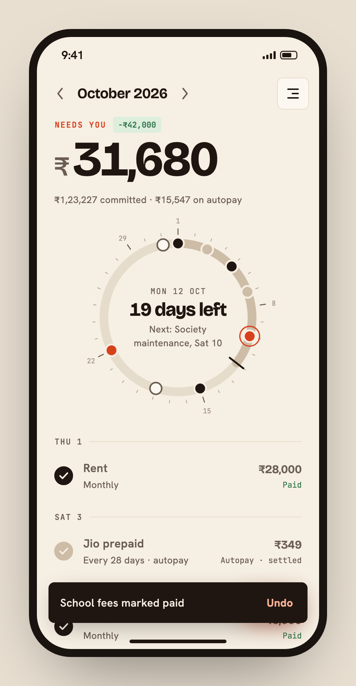 | 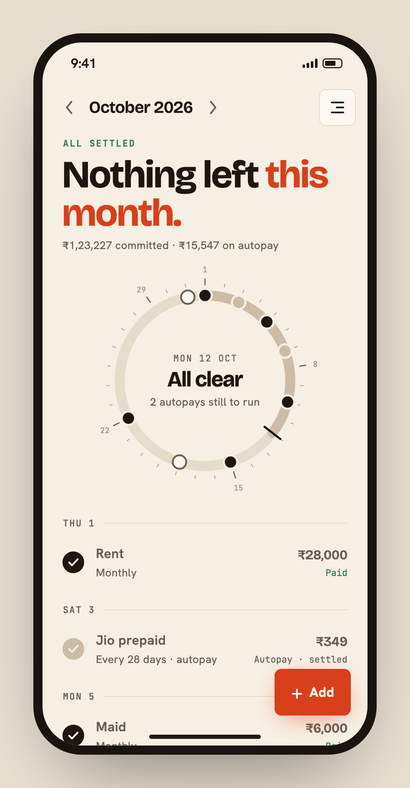 |
| Needs you leads. Autopay is counted, never chased. | Drag the ring. The list follows the handle. | Total counts down, tick fills, undo waits. | A finished state, not a prompt. |

### Edit, settings, accessibility

| 1e Edit sheet | 1f Settings | 1g 200% text |
|:-:|:-:|:-:|
| 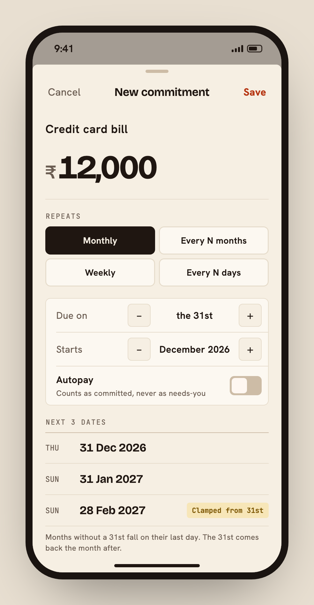 | 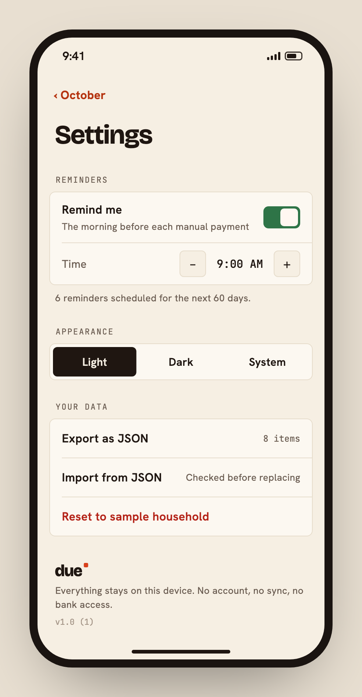 | 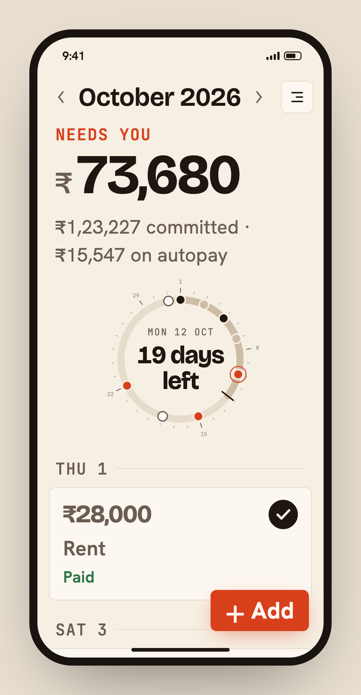 |
| The next 3 dates show the Feb clamp before you save. | Reminders, appearance, your data. | Rows stack, the dial steps down. |

### Dark

| 1h Month | 1i Marked paid | 1j Edit sheet | 1k Settings |
|:-:|:-:|:-:|:-:|
| 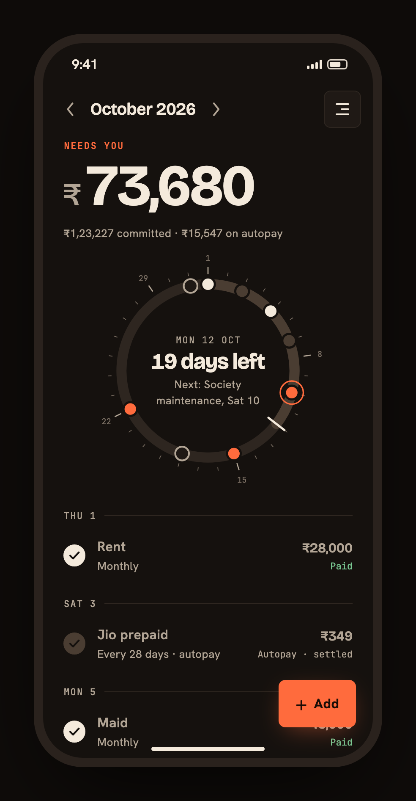 | 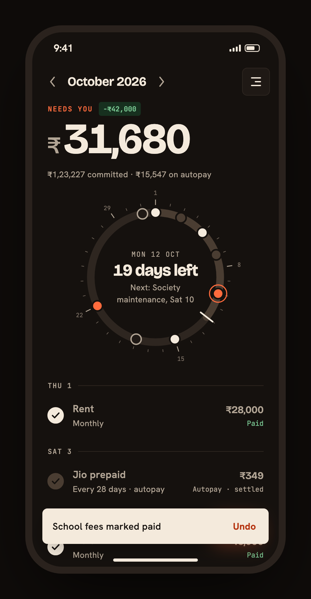 | 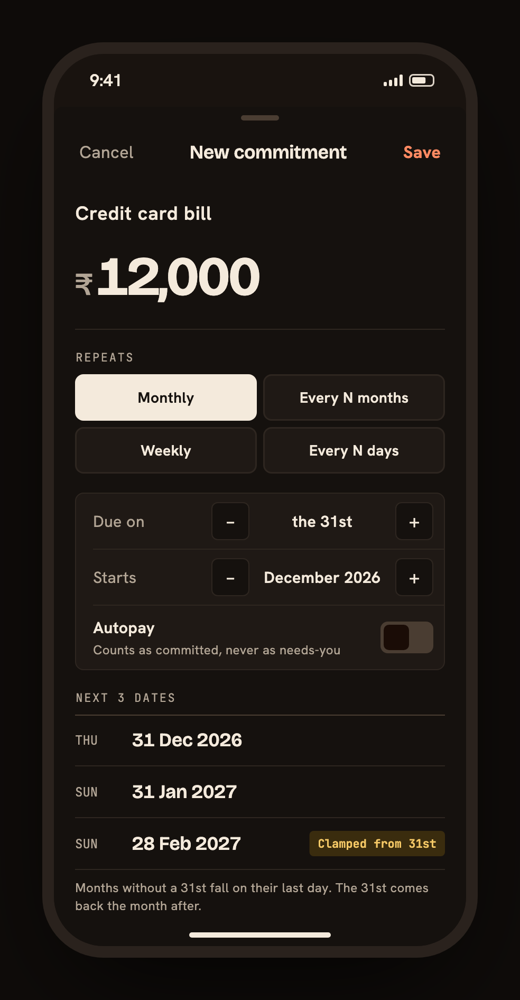 | 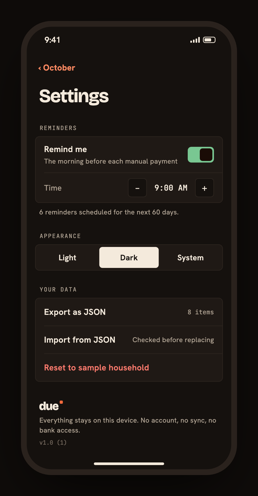 |

### Wide: macOS and desktop web

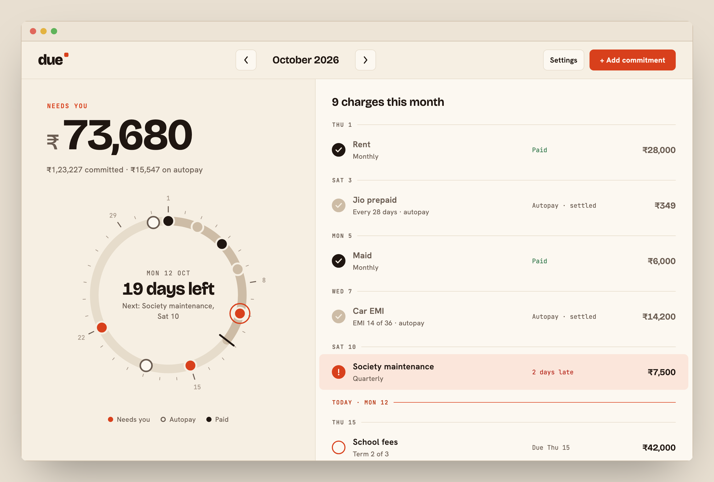

<details>
<summary>Dark</summary>
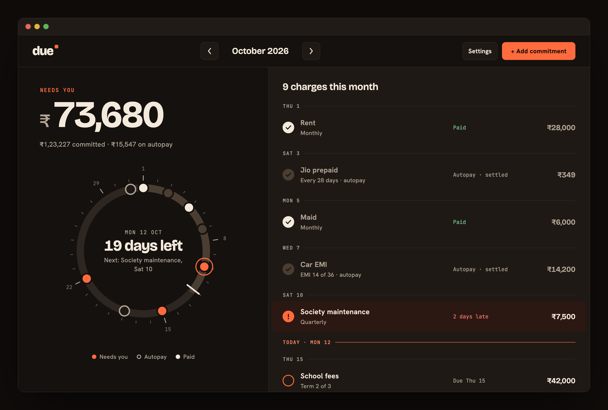
</details>

### iOS home screen widgets

| Light | Dark |
|:-:|:-:|
| 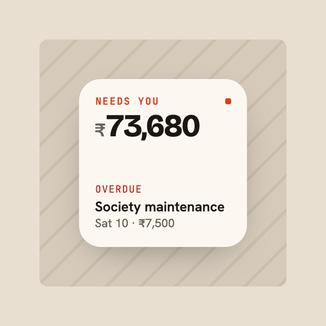 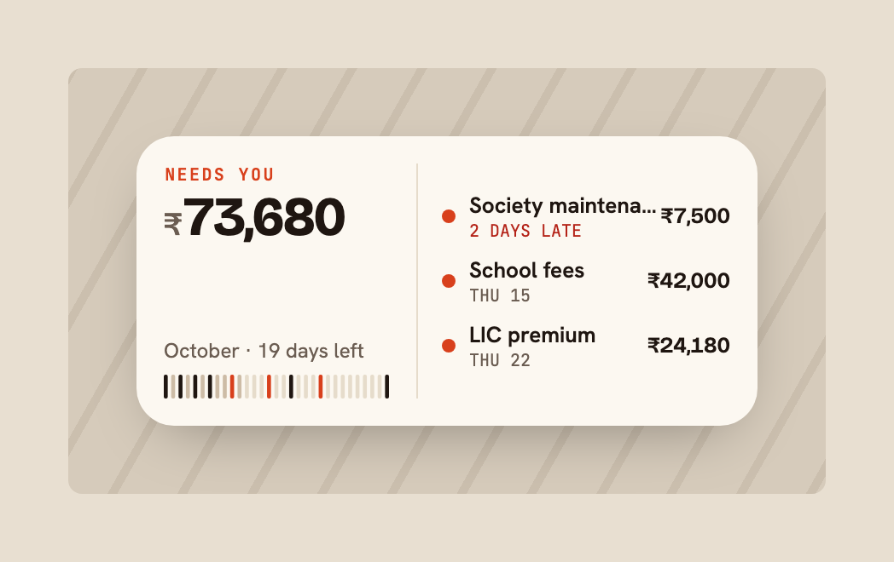 | 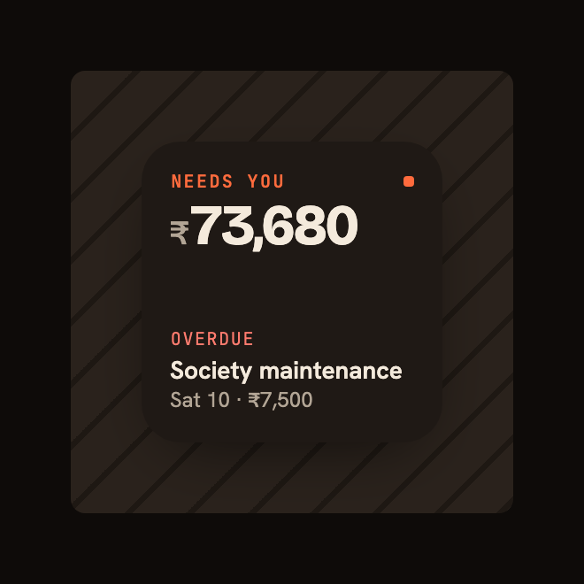 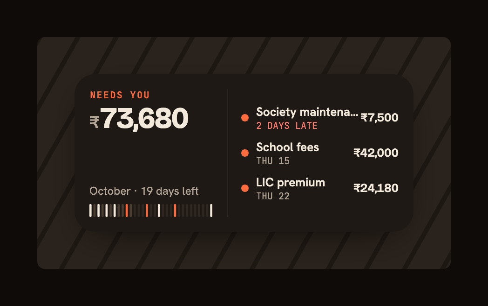 |

## What this demonstrates

- **A custom-drawn, interactive control.** The month dial ([`due_dial.dart`](packages/due_kit/lib/src/components/month/dial/due_dial.dart), [`dial_painter.dart`](packages/due_kit/lib/src/components/month/dial/dial_painter.dart)) is a `CustomPainter`:
  - you scrub it with a drag that claims the pointer, so it doesn't fight the scroll view
  - each new day gives a selection haptic
  - mark colours animate when an item changes state
  - VoiceOver treats it as an adjustable control, with a label on every mark
- **A recurrence engine for real household bills.** Monthly on the 31st through February, yearly on 29 Feb, 28-day prepaid plans drifting through the calendar, quarterly bills, school terms and EMIs that end. The rules are in [`docs/recurrence.md`](docs/recurrence.md) and the tests sit next to the code.
- **A design kit with a token pipeline.** [`design/tokens.json`](design/tokens.json) generates both the Dart tokens and the SwiftUI tokens, so the app and the iOS widget can't drift apart. The kit ([`packages/due_kit`](packages/due_kit/lib)) has one component per file, takes plain view models, and has its own tests and a [Widgetbook catalog](https://avinava.github.io/due/kit/).
- **Design-to-code alignment you can check.** Each of the 15 design frames has a fixture that runs the real app. The same fixture drives the catalog, a golden test and the screenshots above.
- **Native platform work.** A SwiftUI WidgetKit extension reads a snapshot computed in Dart through an App Group. Local notifications are scheduled the morning before each manual payment, kept within iOS's 64-notification limit.
- **Local-first storage everywhere.** drift on SQLite runs natively and on the web (wasm with IndexedDB). Backups are versioned JSON, checked in full before anything is replaced.
- **Accessibility as a layout.** At 200% text the screen changes shape (frame 1g) instead of overflowing. Rows read as single labelled buttons, and the total is a live region.
- **Clean layers.** Pure domain, pure view models, a repository interface, and platform seams behind interfaces that tests swap out. See [`docs/architecture.md`](docs/architecture.md).

## Design

- **Paper and ink, one accent.** Paper `#F6EFE3`, ink `#1F1611`, accent `#D8401C`, with a re-tuned dark set.
- **Type.** Bricolage Grotesque for figures, Hanken Grotesk for names, JetBrains Mono for dates and labels, all with tabular numerals and Indian grouping.
- **Further reading.** Principles, states, motion and accessibility are in [`docs/design.md`](docs/design.md).

## Run it

```sh
mise install          # Flutter, pinned in .mise.toml
mise run gate         # format, analyze, tests (kit, app, frame goldens), web build
mise run app          # macOS
mise run kit          # the design kit in Chrome
mise run web          # app and kit for GitHub Pages, into build/site
```

The repo is a pub workspace: `app/` (the app), `packages/due_kit/` (the design kit), `catalog/` (Widgetbook, frames, goldens). [`AGENTS.md`](AGENTS.md) has the conventions.

## Privacy

Everything stays on the device. Due has no account, no server, no analytics and no bank access. Export gives you your data as a JSON file.

## Licence

The code is [MIT](LICENSE). The fonts are under the SIL Open Font License; see [`OFL.txt`](packages/due_kit/assets/fonts/OFL.txt).
