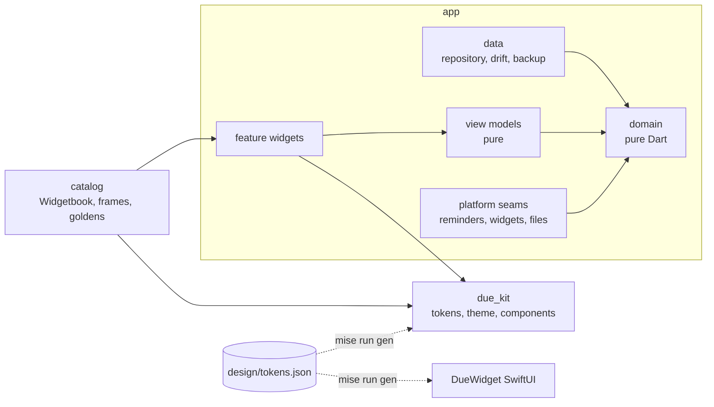

# Architecture

## Layers

**Domain** (`app/lib/domain`) is pure Dart with no Flutter imports. Every date is a UTC midnight, so day arithmetic never crosses daylight saving.

- `Cadence` is a sealed class with four variants.
- `occurrencesIn` and `upcoming` are the whole recurrence API.
- `MonthBrief` turns commitments plus paid keys into the month: totals, states and day groups.
- `planReminders` works out the notification plan.

**Data** (`app/lib/data`) defines `CommitmentRepository` as an interface, with two implementations:

- `DriftCommitmentRepository`: SQLite through drift, with web storage on IndexedDB through wasm.
- `MemoryCommitmentRepository`: used by the catalog and tests.

Dates are stored as `yyyy-mm-dd` text so no time zone can move them. Cadences are stored as JSON through `CadenceCodec`, the same codec the backup file uses.

**View models** (`features/*/…_view_model.dart`, `edit_form.dart`, `widget_snapshot.dart`) are pure. They turn a `MonthBrief` into strings and kit models, so the design's copy is unit-tested without pumping widgets.

**Feature widgets** lay out kit components and send intents to controllers. They hold no business rules.

**State** is Riverpod:

- `todayProvider` is the date from `clockProvider`. It moves on at local midnight and when the app resumes on a new day.
- `householdProvider` streams the stored household.
- `MonthController` holds what is not stored: the month offset, the scrubbed day, the highlight and the snackbar.
- `monthViewProvider` combines the two.
- `SettingsController` keeps preferences in the database's prefs table.

**Routing** is go_router with two places: `/` and `/settings`. The edit sheet is a modal, a bottom sheet on phones and a dialog on wide windows.

**Platform seams** (`app/lib/platform`) are interfaces with real and no-op implementations, chosen per platform:

- `ReminderScheduler`: local notifications on iOS and macOS. It asks for permission the first time there is something to schedule, and runs one replacement at a time so a stale plan never outlives a newer one.
- `HomeWidgets`: WidgetKit through an App Group.
- `BackupFiles`: the share sheet and the file picker.

`platformSyncProvider` keeps reminders and the widget in step with the data.

## The design kit

`packages/due_kit` has no knowledge of the app.

- `foundation/` holds the generated tokens, the `DueTheme` extension, `DueType` and the large-text switch.
- `components/` holds one public widget per file, grouped by role.

The fonts ship in the package, and only Bricolage Grotesque draws ₹.

## The catalog

`catalog` runs the real app shell on an in-memory household with the clock fixed:

- One `FrameScene` per design frame. The same scenes feed Widgetbook, the goldens (`mise run golden`) and the README screenshots (`mise run shots`), so all three always agree.
- `HomeWidgetPreview` draws the iOS widgets in Flutter from the same `WidgetSnapshot` the Swift extension reads.

## The iOS widget

`app/ios/DueWidget` is a SwiftUI WidgetKit extension. The app writes a week of dated `WidgetSnapshot`s (`widgetTimeline`) as JSON to the `group.dev.avi.due` App Group through `home_widget`, then reloads the timeline. The widget shows one entry per day, so it moves on at midnight without the app. The Swift side only lays it out, using the generated `DueTokens.g.swift` and the bundled fonts. `tool/ios/add_widget_target.rb` adds the target to the Xcode project.
